# Database Design

Team: The Foreign Key Club  
Course: CS 411 Database Systems  
Stage: PT1 Stage 3 - Database Implementation and Indexing

---

## 1. Data Loading and Cleaning

### 1.1 Database Environment and Connection Verification

The project database was implemented in MySQL. The database environment was verified using a terminal query that printed the MySQL version, version comment, server hostname, server port, current database, connected user, login user, and timestamp. This also confirms that the MySQL version supports `EXPLAIN ANALYZE`.

```sql
SELECT
  VERSION() AS mysql_version,
  @@version_comment AS version_comment,
  @@hostname AS server_hostname,
  @@port AS server_port,
  DATABASE() AS current_database_name,
  CURRENT_USER() AS connected_user,
  USER() AS login_user,
  NOW() AS checked_at;
```

The original connection-verification screenshot is omitted from this public repository because it contains database account and network details.

### 1.2 Data Definition Language / Table Creation

The following DDL commands were used to create the relational schema for the project database.

```sql
CREATE TABLE Airlines (
 Id INT AUTO_INCREMENT PRIMARY KEY,
 IataCode VARCHAR(10),
 DotId INT,
 Name VARCHAR(100)
);

CREATE TABLE States (
 StateCode VARCHAR(10) PRIMARY KEY,
 StateName VARCHAR(100)
);

CREATE TABLE Cities (
 Id INT AUTO_INCREMENT PRIMARY KEY,
 Name VARCHAR(100),
 StateCode VARCHAR(10) NOT NULL,
 FOREIGN KEY (StateCode) REFERENCES States(StateCode)
);

CREATE TABLE Markets (
 Id INT AUTO_INCREMENT PRIMARY KEY,
 SourceMarketId INT,
 Name VARCHAR(100),
 StateCode VARCHAR(10) NOT NULL,
 Source VARCHAR(100),
 IsMetroArea BOOLEAN,
 FOREIGN KEY (StateCode) REFERENCES States(StateCode)
);

CREATE TABLE Airports (
 Id INT AUTO_INCREMENT PRIMARY KEY,
 IataCode VARCHAR(10),
 Name VARCHAR(100),
 Longitude DECIMAL(9,6),
 Latitude DECIMAL(9,6),
 Datasource VARCHAR(100),
 TimeZone VARCHAR(100),
 CityId INT NOT NULL,
 FOREIGN KEY (CityId) REFERENCES Cities(Id)
);

CREATE TABLE AirportMarkets (
 AirportId INT,
 MarketId INT,
 Source VARCHAR(100),
 PRIMARY KEY (AirportId, MarketId),
 FOREIGN KEY (AirportId) REFERENCES Airports(Id),
 FOREIGN KEY (MarketId) REFERENCES Markets(Id)
);

CREATE TABLE Routes (
 Id INT AUTO_INCREMENT PRIMARY KEY,
 OriginAirportId INT NOT NULL,
 DestinationAirportId INT NOT NULL,
 DistanceMiles INT,
 FOREIGN KEY (OriginAirportId) REFERENCES Airports(Id),
 FOREIGN KEY (DestinationAirportId) REFERENCES Airports(Id)
);

CREATE TABLE FlightRecords (
 Id INT AUTO_INCREMENT PRIMARY KEY,
 Year INT,
 Month INT,
 Day INT,
 DayOfWeek INT,
 RouteId INT NOT NULL,
 MarketingAirlineId INT NOT NULL,
 MarketingFlightNumber VARCHAR(20),
 OperatingAirlineId INT NOT NULL,
 OperatingFlightNumber VARCHAR(20),
 TailNumber VARCHAR(20),
 ScheduledDeptTime VARCHAR(10),
 ActualDeptTime VARCHAR(10),
 DeptDelayMinutes INT,
 ArrDelayMinutes INT,
 ActualArrTime VARCHAR(10),
 ScheduledArrTime VARCHAR(10),
 Cancelled BOOLEAN,
 Diverted BOOLEAN,
 ScheduledElapsedTimeMinutes INT,
 ActualElapsedTimeMinutes INT,
 FOREIGN KEY (RouteId) REFERENCES Routes(Id),
 FOREIGN KEY (MarketingAirlineId) REFERENCES Airlines(Id),
 FOREIGN KEY (OperatingAirlineId) REFERENCES Airlines(Id)
);

CREATE TABLE DelayCauses (
 Id INT AUTO_INCREMENT PRIMARY KEY,
 Code VARCHAR(20),
 Name VARCHAR(100),
 Description VARCHAR(255)
);

CREATE TABLE FlightDelayCause (
 FlightRecordId INT,
 DelayCauseId INT,
 DelayMinutes INT,
 PRIMARY KEY (FlightRecordId, DelayCauseId),
 FOREIGN KEY (FlightRecordId) REFERENCES FlightRecords(Id),
 FOREIGN KEY (DelayCauseId) REFERENCES DelayCauses(Id)
);

CREATE TABLE AirfareMarkets (
 Year INT,
 Quarter INT,
 OriginMarketId INT,
 DestMarketId INT,
 AverageFare DECIMAL(10,2),
 LowestAirlineFare DECIMAL(10,2),
 LowestFareAirlineId INT,
 PRIMARY KEY (Year, Quarter, OriginMarketId, DestMarketId),
 FOREIGN KEY (OriginMarketId) REFERENCES Markets(Id),
 FOREIGN KEY (DestMarketId) REFERENCES Markets(Id),
 FOREIGN KEY (LowestFareAirlineId) REFERENCES Airlines(Id)
);

CREATE TABLE Users (
 Id INT AUTO_INCREMENT PRIMARY KEY,
 UserName VARCHAR(100),
 Email VARCHAR(100),
 PasswordHash VARCHAR(255),
 CreatedTimestamp DATETIME,
 UpdatedTimestamp DATETIME
);

CREATE TABLE SavedRoutes (
 Id INT AUTO_INCREMENT PRIMARY KEY,
 UserId INT NOT NULL,
 RouteId INT NOT NULL,
 Name VARCHAR(100),
 Note VARCHAR(255),
 UpdatedTimestamp DATETIME,
 CreatedTimestamp DATETIME,
 FOREIGN KEY (UserId) REFERENCES Users(Id),
 FOREIGN KEY (RouteId) REFERENCES Routes(Id)
);
```

### 1.3 Data Preparation

We loaded data from our three datasets into respective staging tables using Python and the Pandas library for initial cleaning. This included cleaning leading or trailing spaces, removing special character encodings, and preparing source columns for loading into MySQL. After profiling the data and performing preliminary observations, we executed scripts that translated CSV or DAT files into MySQL staging tables with 1:1 mappings to the source data columns. Within these staging tables, we included source information such as file names and row numbers for traceability and debugging.

### 1.4 Staging and Validation

With the data successfully loaded into each staging table, we ran validations to further understand the data and performed a set of IC, IND, and FD checks prior to mapping. These checks helped us understand the characteristics of the datasets and identify potential foreign-key relationship issues before translating the data into the proposed project tables.

The checks included:

- Checking for null or blank values for attributes intended to be inserted into project database tables.
- Checking that the datasets formed valid mappings for the proposed foreign-key relationships.
- Performing preliminary FD checks in the staged dataset to test assumptions about the data.

We used these findings to guide filtering, amendment, and enrichment decisions during the final loading process.

### 1.5 Final Load Process

Since the datasets were first loaded into staging tables, the final population of project database tables was performed using SQL scripts that inserted tuples through `SELECT` statements from the staging tables.

The final load order was:

1. Reference tables
2. Bridge tables
3. Observation/factual tables

### 1.6 Row Counts

We verified table row counts using a consolidated count query across all project tables.

```sql
SELECT 'airlines' AS table_name, COUNT(*) AS row_count FROM airlines
UNION ALL
SELECT 'states', COUNT(*) FROM states
UNION ALL
SELECT 'cities', COUNT(*) FROM cities
UNION ALL
SELECT 'markets', COUNT(*) FROM markets
UNION ALL
SELECT 'airports', COUNT(*) FROM airports
UNION ALL
SELECT 'airportmarkets', COUNT(*) FROM airportmarkets
UNION ALL
SELECT 'routes', COUNT(*) FROM routes
UNION ALL
SELECT 'flightrecords', COUNT(*) FROM flightrecords
UNION ALL
SELECT 'delaycauses', COUNT(*) FROM delaycauses
UNION ALL
SELECT 'flightdelaycause', COUNT(*) FROM flightdelaycause
UNION ALL
SELECT 'airfaremarkets', COUNT(*) FROM airfaremarkets
UNION ALL
SELECT 'users', COUNT(*) FROM users
UNION ALL
SELECT 'savedroutes', COUNT(*) FROM savedroutes;
```

| Table | Row Count |
|---|---:|
| airlines | 1,775 |
| states | 67 |
| cities | 379 |
| markets | 525 |
| airports | 371 |
| airportmarkets | 371 |
| routes | 7,774 |
| flightrecords | 23,299,578 |
| delaycauses | 5 |
| flightdelaycause | 7,837,985 |
| airfaremarkets | 120,035 |
| users | 0 |
| savedroutes | 0 |

The row counts satisfy the Stage 3 requirement of inserting at least 1,000 rows into at least three different tables. In particular, `flightrecords`, `flightdelaycause`, `airfaremarkets`, `routes`, and `airlines` all exceed 1,000 rows.

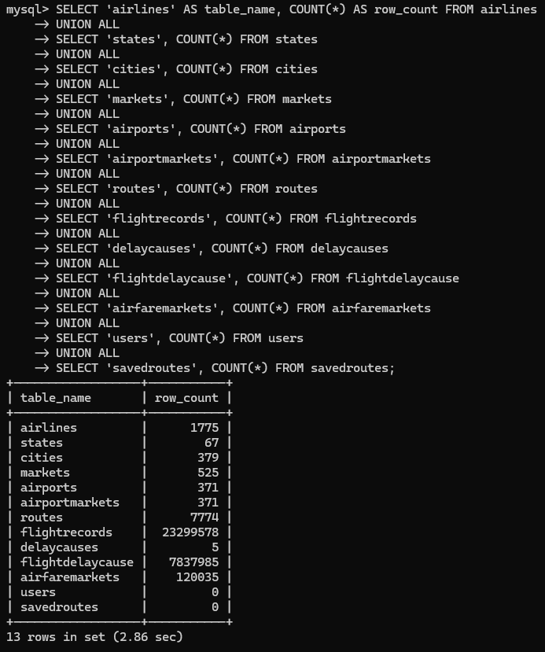

*Figure 2. Consolidated view of all DB tables and associated row counts.*

### 1.7 Key Data Loading Decisions

- We excluded a small set of approximately 100 BTS rows out of roughly 24 million rows because they were missing key identities, route information, flight duration, distance, timing, or similar fields needed for reliable loading.
- We used the BTS data as the key source for airport codes and airline references, supplemented by OpenFlights data to enrich airport metadata with latitude, longitude, and timezone.
- Some airports appeared in the BTS dataset without corresponding OpenFlights metadata. We still included those airports in the `Airports` table because route information is a key source for our application analysis.
- Certain tuples in the DOT airfare dataset did not contain valid lowest-fare carrier codes. For these records, we loaded null values where appropriate instead of forcing invalid airline references.
- Due to varying distance values in BTS flight data for the same directional routes, usually around one mile apart, we selected the most frequently observed distance in miles as the `Routes.DistanceMiles` value for each directional airport pair.

---

## 2. Advanced Query 1: Route Reliability Rating

### 2.1 Query Objective

The goal of Query 1 is to support route reliability search. A user can select an origin airport and destination airport, and the application returns historical route reliability metrics such as average delay, cancellation rate, number of recorded flights, and most common delay cause.

For each year, the query returns:

1. Average arrival delay
2. Number of flights
3. Cancellation rate
4. The delay cause with the largest total delay minutes
5. Total delay minutes for that top delay cause

In the application, the user would provide origin and destination IATA airport codes. For this index design analysis, we hard-coded the route to ORD and LAX to compare index and query performance consistently.

### 2.2 Advanced SQL Concepts Used

This query satisfies the advanced query requirement because it uses several advanced SQL concepts.

First, it joins multiple relations. The query joins `flightrecords`, `flightdelaycause`, and `delaycauses` to connect each flight record with its delay causes and calculate total delay minutes by delay cause. It also uses the `routes` and `airports` tables to identify a route from origin and destination IATA airport codes rather than hard-coding the route ID directly.

Second, it uses aggregation via `GROUP BY`. The query groups flight records by year to calculate yearly route-level statistics with `AVG(flightrecords.ArrDelayMinutes)`, `AVG(flightrecords.Cancelled)`, and `COUNT(*)`. It also groups by year and delay cause to compute `SUM(flightdelaycause.DelayMinutes)` for each delay cause in each year.

Third, the query uses nested subqueries and derived tables. One derived table computes yearly flight statistics, while another computes the most significant delay cause for each year by comparing delay totals against the maximum delay time for that year.

Finally, the query uses a `LEFT JOIN` to preserve yearly route statistics even when a matching delay-cause row is missing. This is useful because flights that were not delayed, or flights without recorded delay causes, should not cause the yearly route summary to disappear.

### 2.3 Final Query SQL Code

```sql
SELECT flight_records_stats.year,
       flight_records_stats.avg_delay,
       flight_records_stats.num_flights,
       flight_records_stats.cancellation_rate,
       yearly_most_common_delay.delay_cause,
       yearly_most_common_delay.total_delay_time
FROM
(
    SELECT flightrecords.year,
           AVG(flightrecords.ArrDelayMinutes) AS avg_delay,
           AVG(flightrecords.Cancelled) AS cancellation_rate,
           COUNT(*) AS num_flights
    FROM flightrecords
    WHERE flightrecords.RouteId = (
        SELECT Id
        FROM routes
        WHERE OriginAirportId = (SELECT Id FROM airports WHERE IataCode = 'ORD')
          AND DestinationAirportId = (SELECT Id FROM airports WHERE IataCode = 'LAX')
    )
    GROUP BY flightrecords.year
) AS flight_records_stats
LEFT JOIN
(
    SELECT
        yearly_cause_totals.year,
        yearly_cause_totals.delay_cause AS delay_cause,
        yearly_cause_totals.delay_time AS total_delay_time
    FROM (
        SELECT
            flightrecords.year,
            delaycauses.Name AS delay_cause,
            SUM(flightdelaycause.DelayMinutes) AS delay_time
        FROM flightrecords
        JOIN flightdelaycause
          ON flightrecords.Id = flightdelaycause.FlightRecordId
        JOIN delaycauses
          ON flightdelaycause.DelayCauseId = delaycauses.Id
        WHERE flightrecords.RouteId = (
            SELECT Id
            FROM routes
            WHERE OriginAirportId = (SELECT Id FROM airports WHERE IataCode = 'ORD')
              AND DestinationAirportId = (SELECT Id FROM airports WHERE IataCode = 'LAX')
        )
        GROUP BY flightrecords.year, delaycauses.Name
    ) AS yearly_cause_totals
    JOIN (
        SELECT year, MAX(delay_time) AS max_delay_time
        FROM (
            SELECT
                flightrecords.year,
                delaycauses.Name AS delay_cause,
                SUM(flightdelaycause.DelayMinutes) AS delay_time
            FROM flightrecords
            JOIN flightdelaycause
              ON flightrecords.Id = flightdelaycause.FlightRecordId
            JOIN delaycauses
              ON flightdelaycause.DelayCauseId = delaycauses.Id
            WHERE flightrecords.RouteId = (
                SELECT Id
                FROM routes
                WHERE OriginAirportId = (SELECT Id FROM airports WHERE IataCode = 'ORD')
                  AND DestinationAirportId = (SELECT Id FROM airports WHERE IataCode = 'LAX')
            )
            GROUP BY flightrecords.year, delaycauses.Name
        ) AS yearly_cause_totals
        GROUP BY year
    ) AS yearly_most_common_delay_time
      ON yearly_cause_totals.year = yearly_most_common_delay_time.year
     AND yearly_cause_totals.delay_time = yearly_most_common_delay_time.max_delay_time
) AS yearly_most_common_delay
  ON flight_records_stats.year = yearly_most_common_delay.year
ORDER BY flight_records_stats.year;
```

### 2.4 Query Result

The query returned 4 rows, which is fewer than 15 rows. This is expected because the dataset covers a time interval spanning 4 calendar years.

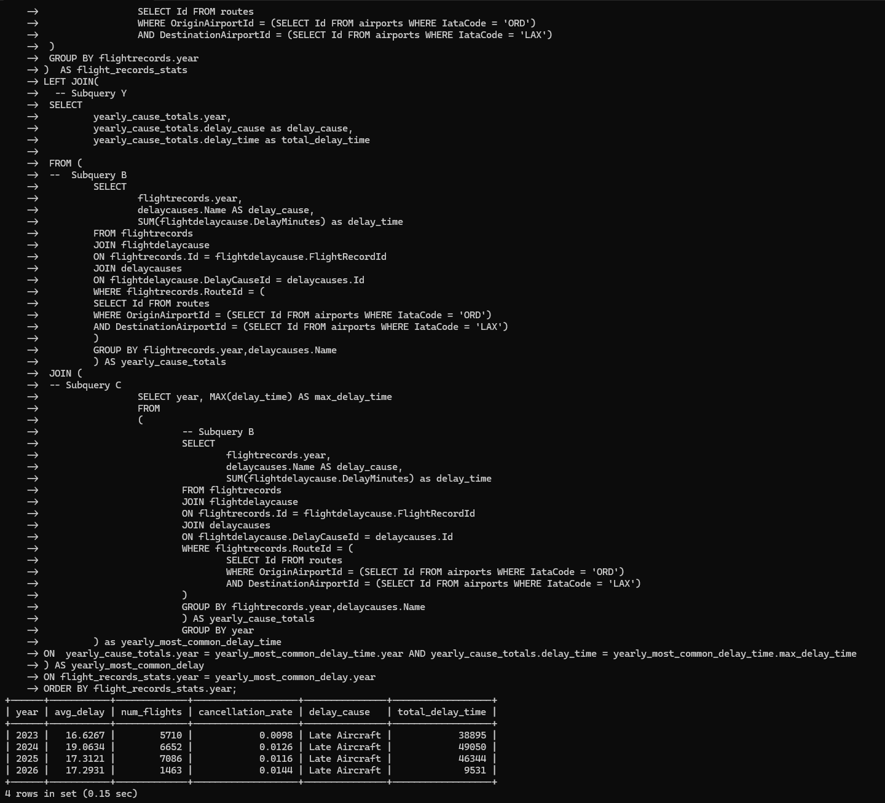

*Query 1 result screenshot. The query returned 4 rows, fewer than 15, because the dataset covers a time interval spanning four calendar years.*

### 2.5 Indexing Analysis

#### 2.5.1 Baseline: Before Adding Query-1-Specific Indexes

Query 1 was evaluated after the database already contained indexes created during Query 3 analysis. Because index creation on the full `FlightRecords` table was extremely time-consuming, we did not rebuild the database from a completely unindexed state for every query. Therefore, the Query 1 baseline represents the performance of Query 1 under the existing database state before adding Query-1-specific indexes. We did not count the pre-existing Query 3 index as one of the three required Query 1 indexing designs.

The baseline used the existing `idx_fr_route_month_cancelled` index, mainly because the query performs lookups into `FlightRecords` using `RouteId`. However, this index does not directly match the query's yearly grouping need, because it contains only `RouteId`, `Month`, and `Cancelled`. The query still has to access matching `FlightRecords` tuples and their `Year` attribute values to perform the grouping.

EXPLAIN ANALYZE result:

- Runtime: approximately 170 ms on the local instance
- Estimated cost: approximately 177,934
- Rows scanned/accessed: approximately 20,911 `FlightRecords` rows per `RouteId` lookup; the lookup occurs 3 times in the plan
- Rows after final result: 4 rows
- Index used: `idx_fr_route_month_cancelled`

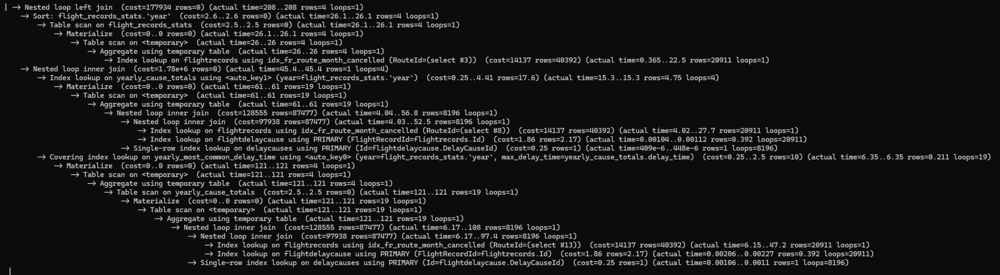

*Query 1 baseline EXPLAIN ANALYZE result before adding Query-1-specific indexes.*

#### 2.5.2 Design 1: Index on `(RouteId, Year)`

SQL code:

```sql
CREATE INDEX idx_fr_route_year
ON FlightRecords(RouteId, Year);
```

This index was designed to support the most resource-heavy scan pattern in the query: filtering `FlightRecords` by `RouteId` and then grouping by `Year`. Since the query repeatedly applies `WHERE flightrecords.RouteId = ...` and then groups records with `GROUP BY flightrecords.Year`, organizing the index by `RouteId` followed by `Year` should make the relevant yearly route data easier for MySQL to access.

EXPLAIN ANALYZE result:

- Runtime: approximately 100 ms on the local instance
- Estimated cost: approximately 194,118
- Rows scanned/accessed: approximately 20,911 `FlightRecords` rows per `RouteId` lookup; the lookup occurs 3 times in the plan
- Index used: `idx_fr_route_year`

The query picked up the new `idx_fr_route_year` index for the grouping and aggregation work. Although the root estimated cost did not improve compared with the baseline, runtime decreased. This suggests that the index simplified the physical access path even though MySQL's estimated root cost did not reflect a major improvement.

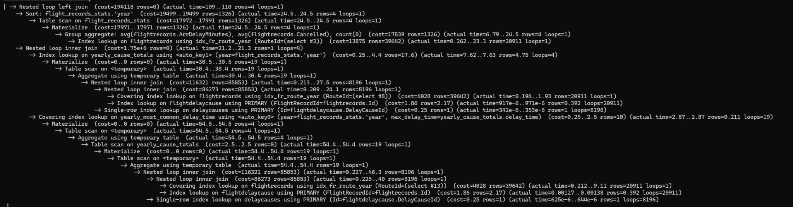

*Query 1 Design 1 EXPLAIN ANALYZE result for index `(RouteId, Year)`.*

#### 2.5.3 Design 2: Index on `(RouteId, Year, Id)`

SQL code:

```sql
DROP INDEX idx_fr_route_year ON FlightRecords;
CREATE INDEX idx_fr_route_year_id
ON FlightRecords(RouteId, Year, Id);
```

This design extended Design 1 by adding `Id`, which participates in the join to `FlightDelayCause`:

```sql
JOIN flightdelaycause ON flightrecords.Id = flightdelaycause.FlightRecordId
```

The goal was to test whether including the `Id` column would reduce the cost of joining from `FlightRecords` into `FlightDelayCause` while still preserving the benefit of indexing by `RouteId` and `Year`.

EXPLAIN ANALYZE result:

- Runtime: approximately 78 ms on the local instance
- Estimated cost: approximately 194,118
- Rows scanned/accessed: approximately 20,911 `FlightRecords` rows per `RouteId` lookup; the lookup occurs 3 times in the plan
- Index used: `idx_fr_route_year_id`

This design improved measured runtime compared with Design 1, but the estimated cost remained the same. Since `Id` is already the primary key of `FlightRecords`, adding it to the secondary index did not significantly improve the optimizer's estimated cost. The runtime improvement may therefore be incidental or related to physical execution details rather than a fundamental plan improvement.

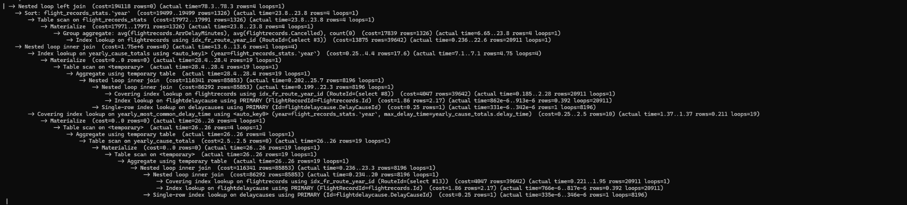

*Query 1 Design 2 EXPLAIN ANALYZE result for index `(RouteId, Year, Id)`.*

#### 2.5.4 Design 3: Index on `(RouteId, Year, ArrDelayMinutes, Cancelled)`

SQL code:

```sql
DROP INDEX idx_fr_route_year_id ON FlightRecords;
CREATE INDEX idx_fr_route_year_delay_cancelled
ON FlightRecords(RouteId, Year, ArrDelayMinutes, Cancelled);
```

This design targets the query's route filtering, yearly grouping, and aggregate calculations:

```sql
WHERE RouteId = ...
GROUP BY Year
AVG(ArrDelayMinutes)
AVG(Cancelled)
COUNT(*)
```

By including `ArrDelayMinutes` and `Cancelled`, the index can support the columns used in the aggregation calculations, not only the filtering and grouping columns.

EXPLAIN ANALYZE result:

- Runtime: approximately 85 ms on the local instance
- Estimated cost: approximately 190,612
- Rows scanned/accessed: approximately 20,911 `FlightRecords` rows per `RouteId` lookup; the lookup occurs 3 times in the plan
- Index used: `idx_fr_route_year_delay_cancelled`

Although this index did not produce the fastest runtime, it improved the grouping and aggregation portion of the plan. The cost of the aggregation grouping dropped by roughly 10,000, from about 14,137 to 4,202. This demonstrates that the index improved the route/year aggregation work even though the total query cost remained close to the other designs.

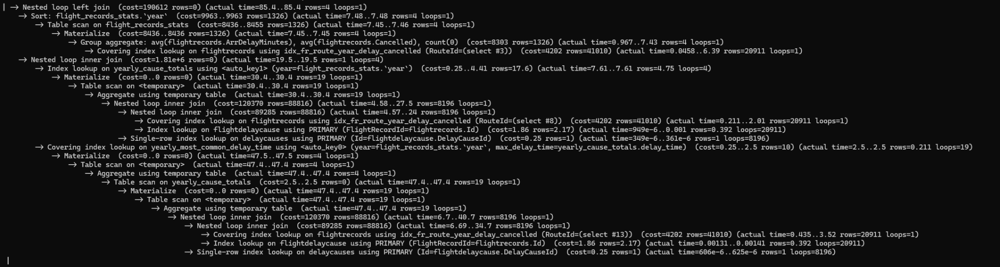

*Query 1 Design 3 EXPLAIN ANALYZE result for index `(RouteId, Year, ArrDelayMinutes, Cancelled)`.*

#### 2.5.5 Indexing Results Summary

| Test | Index Design | EXPLAIN ANALYZE Cost | Runtime | Index Used |
|---|---|---:|---:|---|
| Baseline | Existing PK/FK indexes + `idx_fr_route_month_cancelled` | 177,934 | 208 ms | `idx_fr_route_month_cancelled` |
| Design 1 | `(RouteId, Year)` | 194,118 | 110 ms | `idx_fr_route_year` |
| Design 2 | `(RouteId, Year, Id)` | 194,118 | 78 ms | `idx_fr_route_year_id` |
| Design 3 | `(RouteId, Year, ArrDelayMinutes, Cancelled)` | 190,612 | 85 ms | `idx_fr_route_year_delay_cancelled` |

#### 2.5.6 Performance Gains and Degradations

Compared with the baseline, Design 1 improved runtime from 208 ms to 110 ms, or about 1.8x faster. Design 2 improved runtime from 208 ms to 78 ms, or about 2.7x faster. Design 3 improved runtime from 208 ms to 85 ms, or about 2.4x faster. The estimated root costs did not improve as much as the runtime numbers, which is likely due to the repeated structure of the subqueries and the fact that the query still needs to interact with `FlightDelayCause` for delay-cause aggregation.

The main EXPLAIN ANALYZE improvement was not just in the root cost but in specific operations. The plan changed from repeated index lookups using `idx_fr_route_month_cancelled` and temporary-table aggregation toward covering index lookups using `idx_fr_route_year_delay_cancelled` for the `FlightRecords` portion. This simplified route/year grouping and helped the aggregation operations even if the query still needed to do additional work for the delay-cause side.

#### 2.5.7 Final Index Design Selected

For Query 1, we selected Design 3 as the best final index design:

```sql
CREATE INDEX idx_fr_route_year_delay_cancelled
ON FlightRecords(RouteId, Year, ArrDelayMinutes, Cancelled);
```

Design 3 was selected because it is the most relevant to Query 1's actual use case. It covers the most important fields involved in expensive `FlightRecords` access and route-level yearly aggregation. `RouteId` is critical because the query repeatedly filters by selected route, `Year` is the grouping attribute, and `ArrDelayMinutes` and `Cancelled` are used to calculate the core reliability metrics. Even though Design 2 had the fastest measured runtime in this specific run, Design 3 produced more meaningful plan simplification for the route reliability query pattern and better supports variations in selected origin/destination routes.

Additional result screenshots:

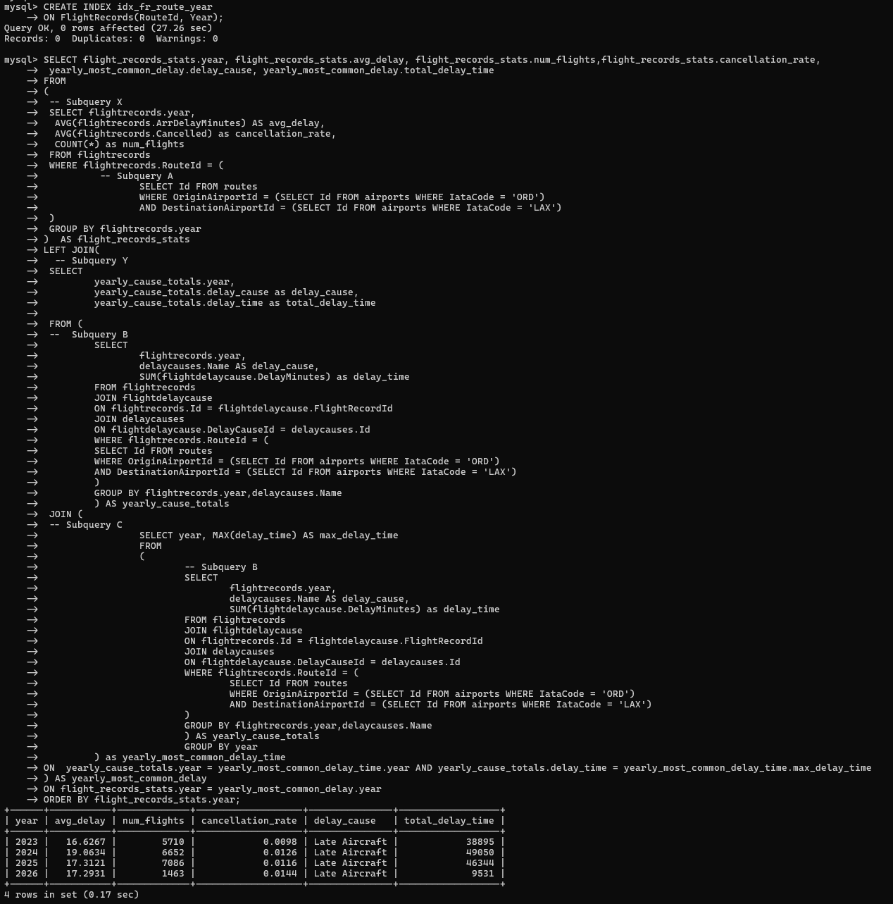

*RouteId, Year.*

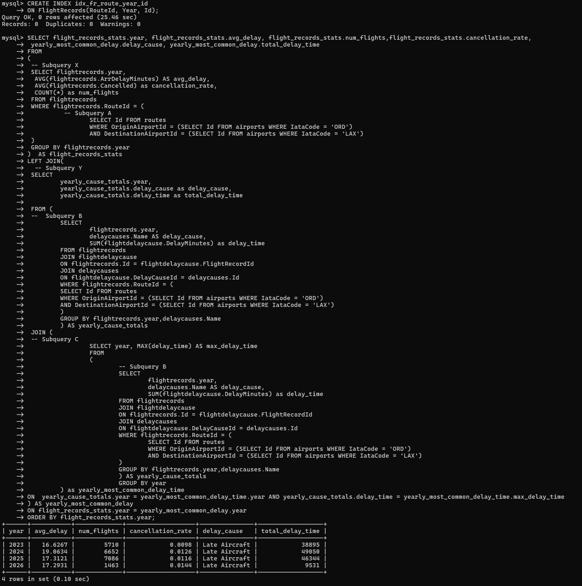

*RouteId, Year, Id.*

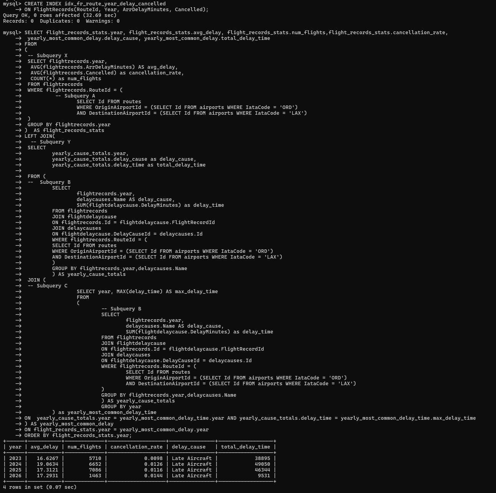

*RouteId, Year, ArrDelayMinutes, Cancelled.*

---

## 3. Advanced Query 2: Airline Cancellation Rates

### 3.1 Query Objective

The goal of Query 2 is to measure route cancellation rates by season. This query is relevant to the flight delay/tracker application because users may want to compare route reliability based on seasonal consistency. Certain routes may be more or less reliable depending on the season in which flights take place.

### 3.2 Advanced SQL Concepts Used

This query satisfies the advanced query requirement because it uses multiple required SQL concepts.

First, it joins multiple relations. The query joins `flightrecords`, `routes`, and two instances of `airports` to connect flight records with route and airport information. The origin and destination airport joins make the output meaningful to users by returning airport IATA codes instead of internal route identifiers only.

Second, it uses aggregation via `GROUP BY`. The query groups route records by route, origin airport, destination airport, and derived season. It then calculates total flights, cancelled flights, and cancellation rate with `COUNT(*)`, `SUM(fr.Cancelled)`, and a derived cancellation-rate expression.

The query also uses a derived table to convert months into seasons and a window function to compute the cancellation-rate spike relative to the average route cancellation rate.

### 3.3 Final Query SQL Code

```sql
WITH seasons AS (
    SELECT
        r.Id AS RouteId,
        oA.IataCode AS OriginAirport,
        dA.IataCode AS DestinationAirport,
        fr.CurSeason,
        COUNT(*) AS TotalFlights,
        SUM(fr.Cancelled) AS CancelledFlights,
        ROUND(1.0 * SUM(fr.Cancelled) / COUNT(*), 2) AS CancellationRate
    FROM (
        SELECT
            RouteId,
            Month,
            Cancelled,
            CASE
                WHEN Month IN (12, 1, 2) THEN 'Winter'
                WHEN Month IN (3, 4, 5) THEN 'Spring'
                WHEN Month IN (6, 7, 8) THEN 'Summer'
                ELSE 'Fall'
            END AS CurSeason
        FROM flightrecords
    ) fr
    JOIN routes r
      ON fr.RouteId = r.Id
    JOIN airports oA
      ON r.OriginAirportId = oA.Id
    JOIN airports dA
      ON r.DestinationAirportId = dA.Id
    GROUP BY
        r.Id,
        oA.IataCode,
        dA.IataCode,
        fr.CurSeason
)
SELECT *,
       CancellationRate - AVG(CancellationRate) OVER (PARTITION BY RouteId) AS Spike
FROM seasons
ORDER BY CancellationRate DESC;
```

### 3.4 Query Result

The query result is ordered by cancellation rate. The top results include several low-flight-count outliers where the cancellation rate is 1.0, which is expected when a route-season pair has very few flights.

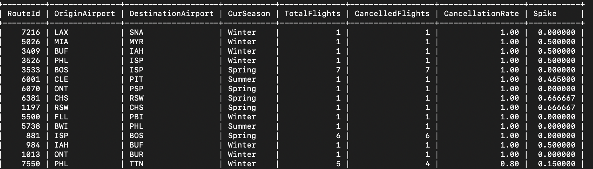

*Query 2 results, top 15. The query is ordered by cancellation rate, so the routes pictured include low-flight-count outliers with a cancellation rate of 1.0.*

### 3.5 Indexing Analysis

#### 3.5.1 Baseline

The baseline analysis used existing indexes and scanned the full `flightrecords` table of roughly 23 million rows. The baseline indexes were not counted as part of the three required custom indexing designs.

EXPLAIN ANALYZE result:

- Runtime: approximately 11 hours 57 minutes
- Rows scanned: approximately 23 million rows
- Existing/default indexes only were used for the baseline

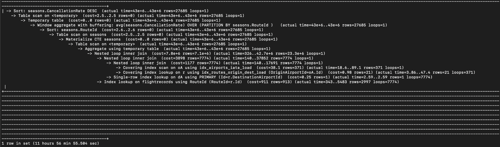

*Query 2 baseline EXPLAIN ANALYZE. Baseline runtime was approximately 11 hours and 57 minutes and scanned all 23 million rows.*

#### 3.5.2 Design 1: Index on `(RouteId, Month, Cancelled)`

SQL code:

```sql
CREATE INDEX idx_fr_route_month_cancelled
ON flightrecords (RouteId, Month, Cancelled);
```

This index covers the main columns from `flightrecords` used by the query. `RouteId` supports the join and grouping by route, `Month` supports the season derivation, and `Cancelled` supports the cancellation-count and cancellation-rate calculations. Since the query must process route/month/cancellation information across a very large fact table, this index is meant to reduce the amount of base-table access needed during aggregation.

EXPLAIN ANALYZE and runtime observations:

- Runtime: approximately 47 minutes
- Speedup: approximately 11 hours 10 minutes faster than baseline
- Percent speedup: approximately 93.44%
- Index used: `idx_fr_route_month_cancelled`


*Indexes RouteId, Month, Cancelled: approximately 47 minutes.*

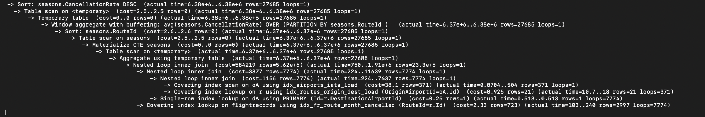

*Query 2 Design 1 EXPLAIN ANALYZE for index `(RouteId, Month, Cancelled)`.*

#### 3.5.3 Design 2: Index on `(RouteId, Cancelled, Month)`

SQL code:

```sql
CREATE INDEX idx_fr_route_cancelled_month
ON flightrecords (RouteId, Cancelled, Month);
```

This index tests whether changing the order of `Cancelled` and `Month` improves performance. Both columns are used by the query, but their order can affect how MySQL uses the composite index. Keeping `RouteId` first still supports route-level grouping and joins, while placing `Cancelled` before `Month` tests whether cancellation aggregation benefits from earlier access to the cancellation flag.

EXPLAIN ANALYZE and runtime observations:

- Runtime: approximately 45 minutes
- Speedup: approximately 11 hours 12 minutes faster than baseline
- Percent speedup: approximately 93.72%
- Index used: `idx_fr_route_cancelled_month`


*Indexes RouteId, Cancelled, Month: approximately 45 minutes.*

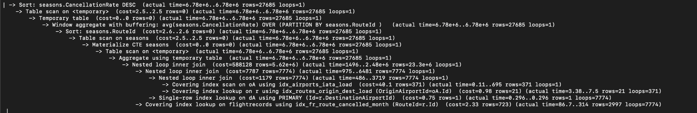

*Query 2 Design 2 EXPLAIN ANALYZE for index `(RouteId, Cancelled, Month)`.*

#### 3.5.4 Design 3: Index on `(Month, RouteId, Cancelled)`

SQL code:

```sql
CREATE INDEX idx_fr_month_cancelled_route
ON flightrecords (Month, RouteId, Cancelled);
```

This design puts `Month` first because the query derives season from `Month`. The goal was to test whether organizing records by month first would help MySQL group records into seasons more efficiently before applying route-level aggregation. This design is useful to compare against the two `RouteId`-first indexes because the query has both route and season dimensions.

EXPLAIN ANALYZE and runtime observations:

- Runtime: approximately 53 minutes
- Speedup: approximately 11 hours 3 minutes faster than baseline
- Percent speedup: approximately 92.47%
- Index used: `idx_fr_month_cancelled_route`

Design 3 improved substantially over the baseline, but it was slower than Design 1 and Design 2. This suggests that for this query, keeping `RouteId` first is more useful than putting `Month` first, likely because the grouping and route joins depend strongly on `RouteId`.

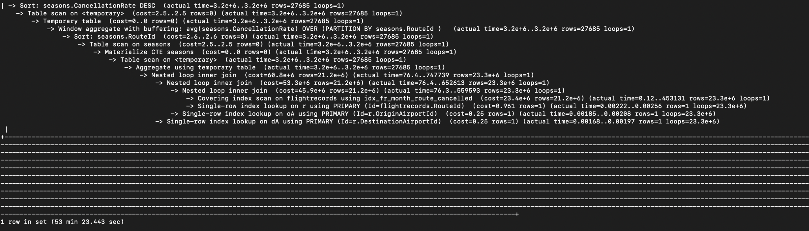

*Query 2 Design 3 EXPLAIN ANALYZE for index `(Month, RouteId, Cancelled)`. Runtime was approximately 53 minutes.*

Note: EXPLAIN ANALYZE was counted with the runtime of the third index, while the second and first indexes did not count EXPLAIN ANALYZE. This effect should overall be small, as the overhead of EXPLAIN ANALYZE should be much cheaper than the process itself. 

#### 3.5.5 Indexing Results Summary

| Test | Index Design | Runtime | Approximate Speedup vs. Baseline | Index Used |
|---|---|---:|---:|---|
| Baseline | Existing indexes only | 11 hr 57 min | N/A | Existing indexes |
| Design 1 | `(RouteId, Month, Cancelled)` | 47 min | 93.44% | `idx_fr_route_month_cancelled` |
| Design 2 | `(RouteId, Cancelled, Month)` | 45 min | 93.72% | `idx_fr_route_cancelled_month` |
| Design 3 | `(Month, RouteId, Cancelled)` | 53 min | 92.47% | `idx_fr_month_cancelled_route` |

#### 3.5.6 Performance Gains and Degradations

All three custom indexes produced a major improvement over the baseline because they each included the core `flightrecords` columns used by the query: route, month/season, and cancellation status. The baseline had to scan approximately 23 million rows, while the custom indexes gave MySQL a more useful access path for the route/season/cancellation aggregation. This explains why all three designs reduced execution time by more than 90%.

Design 2 performed best by a small margin, with a runtime of about 45 minutes. Design 1 was close behind at about 47 minutes. Design 3 was slower at about 53 minutes, which suggests that putting `Month` first was less effective than putting `RouteId` first. This makes sense because the query joins and groups around route identity, then derives seasonal cancellation metrics from the route's records.

#### 3.5.7 Final Index Design Selected

For Query 2, we selected Design 2 as the final index design:

```sql
CREATE INDEX idx_fr_route_cancelled_month
ON flightrecords (RouteId, Cancelled, Month);
```

This design was selected because it produced the lowest overall runtime and the largest observed runtime reduction. It preserves `RouteId` as the leading column, which is important for route-level joins and grouping, while also placing `Cancelled` before `Month` to support cancellation-rate aggregation. The improvement over Design 1 was small, but it was still the best measured option among the three designs. Design 3 showed that month-first indexing was less effective for this query, so the final design keeps route as the leading access pattern.

---

## 4. Advanced Query 3: Airline Reliability Ranking

### 4.1 Query Objective

The goal of Query 3 is to rank airlines by reliability using flight delay and disruption metrics. This query is relevant to the flight delay/tracker application because users may want to compare airlines based on historical reliability rather than only price or route availability.

For this query, October 2023 data was used because January 2023 returned zero rows in the `flightrecords` table. October 2023 contains 635,538 flight records.

The query evaluates airlines using four reliability metrics:

1. Average arrival delay
2. Average departure delay
3. Cancellation rate
4. Diversion rate

An airline receives one reliability point for each metric where it performs better than the overall monthly average. The final output ranks airlines by reliability dimension count, reliability score, and number of flights.

### 4.2 Advanced SQL Concepts Used

This query satisfies the advanced query requirement because it uses at least two required SQL concepts.

First, it joins multiple relations. The query joins airline-level statistics with the `airlines` table so that output rows include airline codes and names. It also uses a `CROSS JOIN` between airline statistics and overall statistics so that each airline can be compared against the overall monthly averages.

Second, it uses aggregation via `GROUP BY`. The query groups flight records by `MarketingAirlineId` and computes metrics with `COUNT(*)` and `AVG(...)`. It also uses CTEs to organize the airline-level and overall monthly statistics into clear intermediate result sets.

### 4.3 Final Query SQL Code

```sql
WITH airline_stats AS (
    SELECT
        fr.MarketingAirlineId,
        COUNT(*) AS num_flights,
        AVG(CASE WHEN fr.Cancelled = 0 THEN fr.ArrDelayMinutes END) AS avg_arr_delay,
        AVG(CASE WHEN fr.Cancelled = 0 THEN fr.DeptDelayMinutes END) AS avg_dept_delay,
        AVG(fr.Cancelled) AS cancel_rate,
        AVG(fr.Diverted) AS divert_rate
    FROM flightrecords fr
    WHERE fr.Year = 2023
      AND fr.Month = 10
    GROUP BY fr.MarketingAirlineId
    HAVING COUNT(*) >= 1000
),
overall_stats AS (
    SELECT
        AVG(CASE WHEN fr.Cancelled = 0 THEN fr.ArrDelayMinutes END) AS overall_avg_arr_delay,
        AVG(CASE WHEN fr.Cancelled = 0 THEN fr.DeptDelayMinutes END) AS overall_avg_dept_delay,
        AVG(fr.Cancelled) AS overall_cancel_rate,
        AVG(fr.Diverted) AS overall_divert_rate
    FROM flightrecords fr
    WHERE fr.Year = 2023
      AND fr.Month = 10
)
SELECT
    al.IataCode AS airline_code,
    al.Name AS airline_name,
    a.num_flights,
    ROUND(a.avg_arr_delay, 2) AS avg_arr_delay,
    ROUND(a.avg_dept_delay, 2) AS avg_dept_delay,
    ROUND(a.cancel_rate * 100, 2) AS cancel_rate_percent,
    ROUND(a.divert_rate * 100, 2) AS divert_rate_percent,
    (
        CASE WHEN a.avg_arr_delay < o.overall_avg_arr_delay THEN 1 ELSE 0 END
        + CASE WHEN a.avg_dept_delay < o.overall_avg_dept_delay THEN 1 ELSE 0 END
        + CASE WHEN a.cancel_rate < o.overall_cancel_rate THEN 1 ELSE 0 END
        + CASE WHEN a.divert_rate < o.overall_divert_rate THEN 1 ELSE 0 END
    ) AS reliability_dimension_count,
    ROUND(
        (
            (100 - LEAST(GREATEST(a.avg_arr_delay, 0), 100))
            + (100 - LEAST(a.cancel_rate * 1000, 100))
            + (100 - LEAST(a.divert_rate * 1000, 100))
        ) / 3,
        2
    ) AS reliability_score
FROM airline_stats a
CROSS JOIN overall_stats o
JOIN airlines al
  ON a.MarketingAirlineId = al.Id
ORDER BY
    reliability_dimension_count DESC,
    reliability_score DESC,
    a.num_flights DESC
LIMIT 20;
```

### 4.4 Query Result

The query returned 10 rows, which is fewer than 15 rows. This happened because only 10 distinct airlines exist in the `flightrecords` table for the selected criteria. Therefore, the result screenshot shows all returned rows instead of 15 rows.

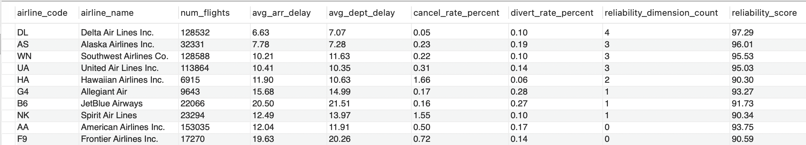

*Query 3 result screenshot. The query returned 10 rows, fewer than 15, because only 10 distinct airlines exist in the `flightrecords` table for the selected criteria.*

### 4.5 Indexing Analysis

#### 4.5.1 Baseline: Before Adding Custom Indexes

Before adding custom indexes, the `flightrecords` table already had default primary-key and foreign-key-related indexes:

- `PRIMARY` on `Id`
- `RouteId`
- `MarketingAirlineId`
- `OperatingAirlineId`

These default indexes were not counted as part of the three required custom indexing designs. They were only used for the baseline test.

EXPLAIN ANALYZE result:

- Runtime: 1741.723 seconds
- Estimated cost: approximately 2.28e6 / 2.3e6
- Rows scanned: approximately 23.3 million rows
- Rows after filter: 635,538 rows
- Index used: `MarketingAirlineId`

In the baseline test, MySQL used the existing `MarketingAirlineId` index, likely because the query groups records by airline. However, there was no index starting with `Year` and `Month`, even though the query filters by `WHERE fr.Year = 2023 AND fr.Month = 10`. As a result, MySQL scanned approximately 23.3 million rows before applying the year/month filter.

#### 4.5.2 Design 1: Index on `(Year, Month)`

SQL code:

```sql
CREATE INDEX idx_fr_year_month
ON flightrecords (Year, Month);
```

This index was designed to support the most selective part of the query:

```sql
WHERE fr.Year = 2023
AND fr.Month = 10
```

With this index, MySQL can use the B+ Tree index to directly locate October 2023 rows instead of scanning almost the full table.

EXPLAIN ANALYZE result:

- Build time: 1465.668 seconds
- Runtime: 12.741 seconds
- Index lookup cost: approximately 581,388
- Final cost: approximately 312,701
- Rows read: 635,538 rows
- Index used: `idx_fr_year_month`

Design 1 significantly improved query performance. Runtime decreased from 1741.723 seconds to 12.741 seconds because MySQL no longer needed to scan about 23.3 million rows before applying the filter. Instead, it directly located the 635,538 rows where `Year = 2023` and `Month = 10`.

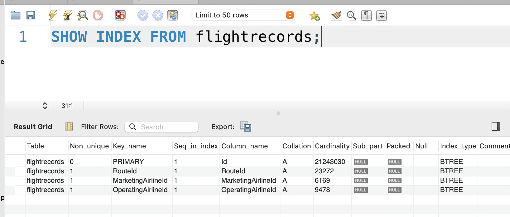

*Query 3 Design 1 EXPLAIN ANALYZE result for index `(Year, Month)`.*

#### 4.5.3 Design 2: Index on `(Year, Month, MarketingAirlineId)`

SQL code:

```sql
DROP INDEX idx_fr_year_month ON flightrecords;
CREATE INDEX idx_fr_year_month_airline
ON flightrecords (Year, Month, MarketingAirlineId);
```

This design extended Design 1 by adding `MarketingAirlineId`, which appears in the query's grouping step:

```sql
GROUP BY fr.MarketingAirlineId
```

The goal was to test whether adding the grouping column would further improve performance after filtering by year and month.

EXPLAIN ANALYZE result:

- Build time: 1429.419 seconds
- Runtime: 14.804 seconds
- Index lookup cost: approximately 586,421
- Final cost: approximately 1.42e6
- Rows read: 635,538 rows
- Index used: `idx_fr_year_month_airline`

Design 2 was still much faster than the baseline, but it was slightly slower than Design 1. This suggests that the biggest improvement came from indexing the year/month filter. Adding `MarketingAirlineId` did not provide enough additional benefit for the `GROUP BY` step because the query still needed to access other columns such as `Cancelled`, `Diverted`, `ArrDelayMinutes`, and `DeptDelayMinutes` to compute reliability metrics.

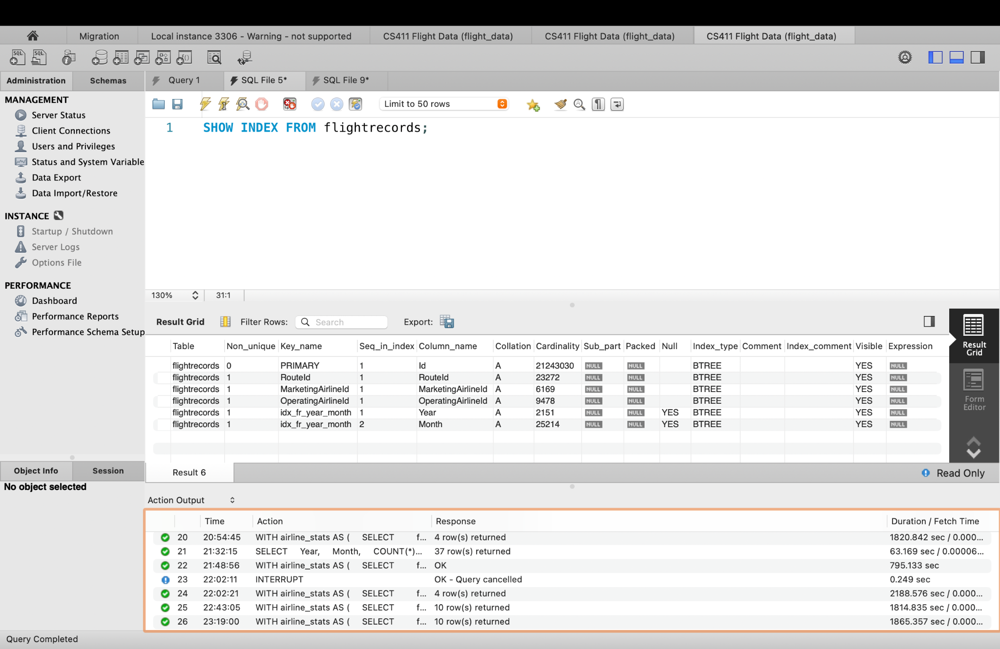

*Query 3 Design 2 EXPLAIN ANALYZE result for index `(Year, Month, MarketingAirlineId)`.*

#### 4.5.4 Design 3: Covering-Style Index

SQL code:

```sql
DROP INDEX idx_fr_year_month_airline ON flightrecords;
CREATE INDEX idx_fr_year_month_airline_reliability
ON flightrecords (
    Year,
    Month,
    MarketingAirlineId,
    Cancelled,
    Diverted,
    ArrDelayMinutes,
    DeptDelayMinutes
);
```

This design was a covering-style index. It included the columns used for filtering, grouping, and metric calculation:

- `Year` and `Month` for the `WHERE` filter
- `MarketingAirlineId` for `GROUP BY` and join to `airlines`
- `Cancelled`, `Diverted`, `ArrDelayMinutes`, and `DeptDelayMinutes` for computing reliability metrics

The goal was to test whether MySQL could compute most of the query directly from the index without repeatedly reading the base table.

EXPLAIN ANALYZE result:

- Build time: exact time unclear due to Workbench interruption; confirmed within approximately 4 hours and 50 minutes
- Runtime: 1.079 seconds
- Covering index lookup cost: approximately 130,863
- Final cost: approximately 1.41e6
- Rows read: 635,538 rows
- Index used: `idx_fr_year_month_airline_reliability`

The important EXPLAIN ANALYZE line was:

```text
Covering index lookup on fr using idx_fr_year_month_airline_reliability
```

Design 3 produced the fastest runtime. Query runtime decreased from 12.741 seconds in Design 1 to 1.079 seconds in Design 3. Compared with the baseline runtime of 1741.723 seconds, this was a major improvement. The reason Design 3 performed best is that MySQL used a covering index lookup. Since the index already contained the columns needed for filtering, grouping, and computing the reliability metrics, MySQL could avoid many extra table lookups.

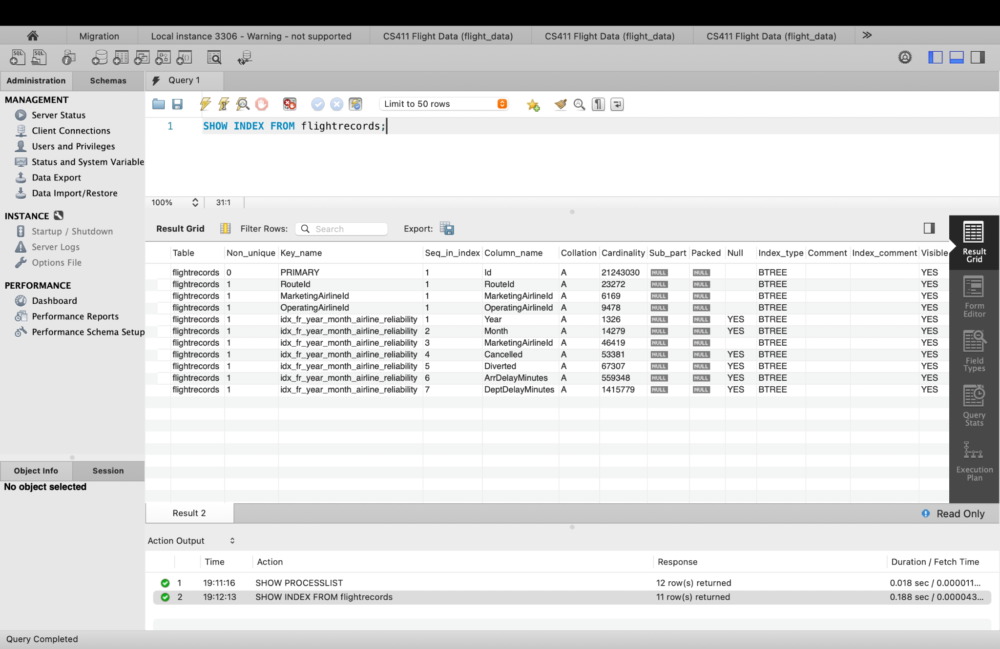

*Query 3 Design 3 covering-style index screenshot for `(Year, Month, MarketingAirlineId, Cancelled, Diverted, ArrDelayMinutes, DeptDelayMinutes)`.*

#### 4.5.5 Indexing Results Summary

| Test | Index Design | Build Time | EXPLAIN ANALYZE Cost | Runtime | Rows Read / Scanned | Index Used | Notes |
|---|---|---:|---:|---:|---:|---|---|
| Baseline | Existing PK/FK indexes only | N/A | ~2.28e6 / ~2.3e6 | 1741.723 sec | 23.3M scanned; 635,538 after filter | `MarketingAirlineId` | No year/month index, so MySQL scanned almost the full table before filtering. |
| Design 1 | `(Year, Month)` | 1465.668 sec | index lookup ~581,388; final ~312,701 | 12.741 sec | 635,538 | `idx_fr_year_month` | Directly located October 2023 rows. |
| Design 2 | `(Year, Month, MarketingAirlineId)` | 1429.419 sec | index lookup ~586,421; final ~1.42e6 | 14.804 sec | 635,538 | `idx_fr_year_month_airline` | Slightly slower than Design 1. |
| Design 3 | `(Year, Month, MarketingAirlineId, Cancelled, Diverted, ArrDelayMinutes, DeptDelayMinutes)` | confirmed within ~4h50m | covering index lookup ~130,863; final ~1.41e6 | 1.079 sec | 635,538 | `idx_fr_year_month_airline_reliability` | Fastest runtime due to covering index lookup. |

#### 4.5.6 Performance Gains and Degradations

Compared with the baseline, Design 1 improved runtime from 1741.723 seconds to 12.741 seconds, or about 136.7x faster. Design 2 improved runtime to 14.804 seconds, or about 117.7x faster than baseline, but it was slightly slower than Design 1. Design 3 improved runtime to 1.079 seconds, or about 1614.2x faster than baseline. Compared with Design 1, Design 3 was about 11.8x faster.

Indexing helped because the query filters by `Year` and `Month`. Without a `(Year, Month)` index, MySQL had to scan nearly the full `flightrecords` table and check each row. After adding an index beginning with `Year` and `Month`, MySQL could directly locate the section of records where `Year = 2023` and `Month = 10`. Design 3 improved this further because the index also contained the columns needed for grouping and reliability metric computation, allowing a covering index lookup.

#### 4.5.7 Final Index Design Selected

For Query 3, we selected Design 3 as the best-performing index:

```sql
CREATE INDEX idx_fr_year_month_airline_reliability
ON flightrecords (
    Year,
    Month,
    MarketingAirlineId,
    Cancelled,
    Diverted,
    ArrDelayMinutes,
    DeptDelayMinutes
);
```

This design was selected because it produced the fastest measured query runtime and used a covering index lookup. Runtime decreased from 1741.723 seconds in the baseline to 1.079 seconds with Design 3. The covering index includes the filter columns, grouping column, and metric columns, so MySQL could compute most of the reliability metrics directly from the index. The tradeoff is that Design 3 had the highest build cost and likely requires more storage and maintenance overhead. If the query is not run frequently, Design 1 on `(Year, Month)` may be more practical because it is simpler and still produced a major performance improvement. Since Query 3 is intended as an important reliability ranking feature, Design 3 is the best choice when repeated query performance is the priority.

Additional screenshots:

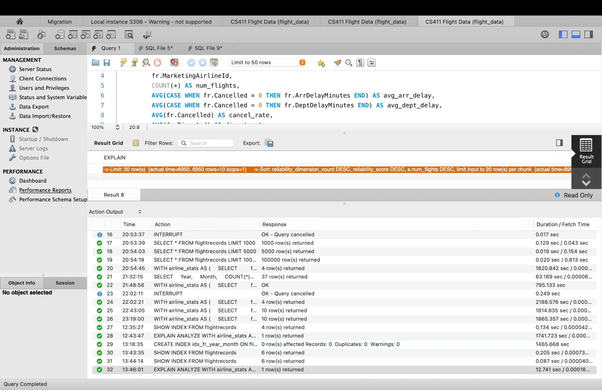

*Year, Month, MarketingAirlineId, Cancelled, Diverted, ArrDelayMinutes, DeptDelayMinutes.*

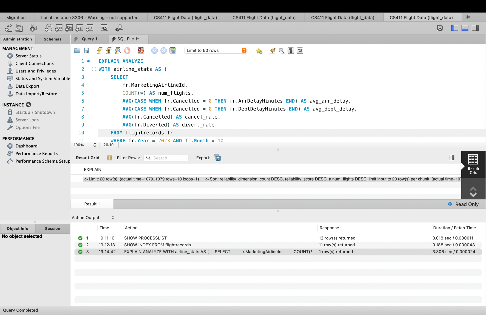

*Notice that: 1.561 sec server-side actual time; 3.813 sec Workbench duration.*

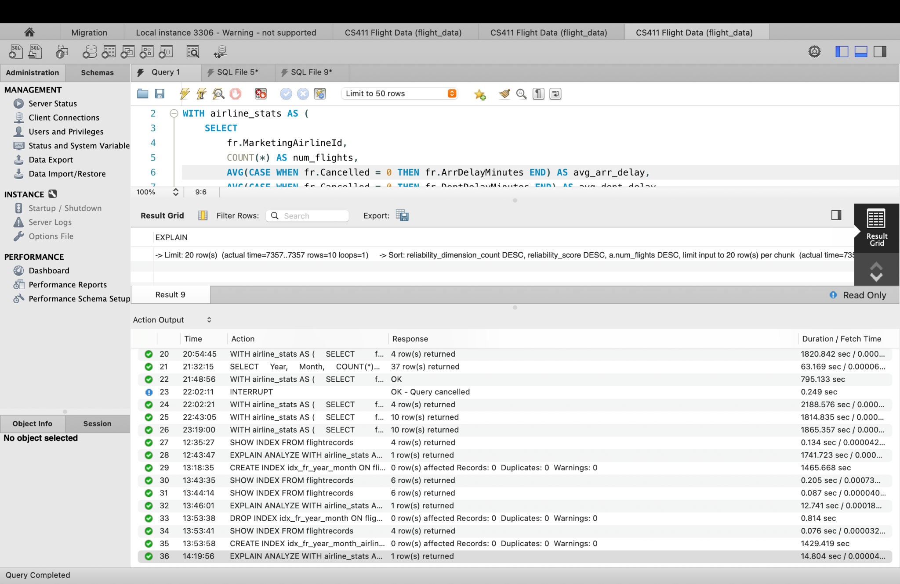

*Year, Month, MarketingAirlineId.*
