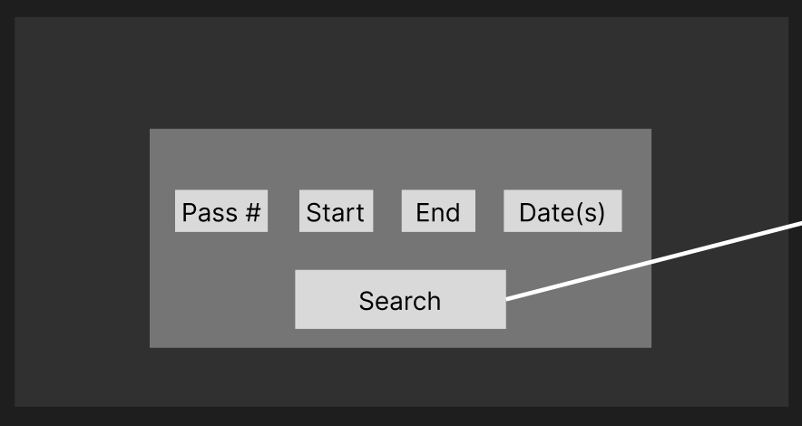
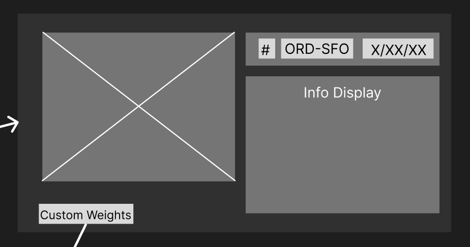
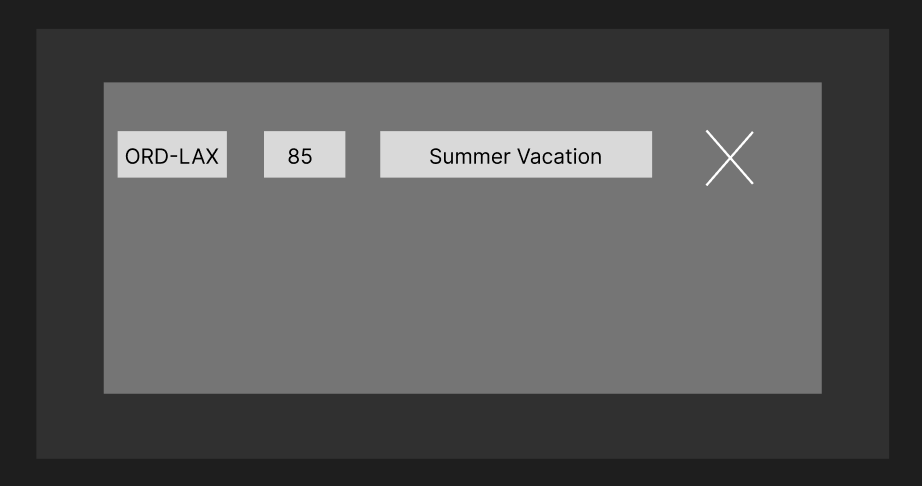

# Stage 1 Project Proposal Template

## 1. Project Title

**Project Name:**  
Flight Tracking Optimizer

**Team Name / Number:**  
The Foreign Key Club / Team 14

**Team Members:**

- Chuck Wang
- Po Lin
- Vismayak Mohanarajan
- Albert Lee

---

## 2. One-Sentence Pitch

Our application helps travelers compare US flight routes using historical reliability, delay, cancellation, airline performance, and airfare data so they can make more informed flight decisions before booking.

---

## 3. Project Summary

### 3.1 High-Level Description

Our project is a flight route analytics web application that helps users evaluate the reliability and cost patterns of US domestic flight routes. Instead of showing the availability or ticket prices, this application focuses on the historic route performance, including average arrival and departure delays, cancellation rates, average delay minutes, delay rates, airline-specific performance, and average airfare trends.

The application combines multiple real-world aviation datasets, including historical on-time performance records, airfare market data, and airport data. Users will be able to search the routes by origin and destination, compare airlines operating on the same route, view common delay causes, and understand whether a route is relatively reliable or risky. The goal is to give user additional context before booking, especially for high-stakes trips where delay could create serious problems.

### 3.2 Target Users

The target users are the travelers who want more than basic flight information before booking the trip. This includes business managers attending time-sensitive meetings, or international travelers catching up a connecting flight. Instead of relying only on the flight prices, users can use this app to evaluate the tradeoff between flight reliability and affordability.

### 3.3 Main Analytical Goal

The main analytical goal of this project is to answer questions such as:

- Which flight route is historically most reliable?
- Which airline performs best on a specific route?
- How does the average airfare compare with route reliability?

---

## 4. Project Usefulness

### 4.1 Motivation

Travel is full of uncertainties especially when the purpose of travel is high-stakes. These types of travel purposes include family visitation, holiday gathering, critical business meetings, etc. Most ticket booking platforms provide route, carrier and price information but fail to supplement available flight data with useful metrics on carrier/flight/route performance that outlines on-time and delay information which should, if provided, prove useful in the decision process of flight bookings. We aim to provide a tool that offers deep historical analysis on flight data collected across 3 separate data sources, for which our users can gain additional insights into securing critical travel plans.

### 4.2 Comparison to Existing Tools

Existing flight booking platforms primarily serve their users through finding and booking available flights by routes and date (e.g. Expedia, Kayak, Priceline, etc.). While historical flight data is available, this data lives behind interfaces such as Openflights.org and serves users with rudimentary data to perform analysis that is distributed through carrier and flight specific searches rather than performing analysis upon historical data across routes.

### 4.3 Expected User Benefit

Users of our platform should be able to perform analysis over their intended travel timeframe, origin and destination, as well as the high-level pricing information based on historical (data availability starts March of 2026 and spans to March of 2024) flight data. For example, they can gain insight into whether their travel timeframe has frequent delays due to weather; perhaps during that timeframe their origin or destination cities may have inclement weather patterns that impact air travel. Another significant use case could be that during particularly busy months (such as national holidays or city-wide events) certain routes experience a high number of carrier-related delays, so that our user may incorporate our application as part of their research. Additionally, our users can assess pricing patterns across different times throughout the year to prioritize months with lower average cost, or even assess if certain pricing patterns they observe through booking platforms is a reasonable increase compared to their other options.

---

## 5. Realness of the Project / Data Sources

### 5.1 Data Source Overview

| # | Data Source | Provider | Format | Approx. Size | What it Provides | Planned Use |
|---:|---|---|---|---|---|---|
| 1 | Department of Transportation Data Website | United States Department of Transportation | CSV | 27 Columns; 120,035 rows | Pricing Data over the last 30 years of “aggregated average fare data for major city-pair markets”. This dataset provides information on origin/destination airports along with fare-related information such as carrier with the highest/lowest fares for a given route and its pricing average. | This dataset will be used for pricing data across certain routes. Since this doesn’t encompass all of the available domestic routes, we will only provide pricing analysis on user queries where data is available. |
| 2 | OpenFlights.org airport, airline and route data | OpenFlights.org | DAT | Airlines data: 8 Columns; 6162 Rows  Airport data: 14 Columns; 7689 Rows | Reference table for extracting airlines and airport information. This dataset also provides lat-long data for airports which could be useful for map displays in our front end application. | We will use the airlines dataset to extract airline full names, alias, and other metadata for UI display. The airport data will be used to extract airport name, city, state, lat/long values, etc. also used for display of route metadata. |
| 3 | Bureau of Transportation Statistics Airline On-Time Statistics | United States Department of Transportation | CSV | 119 Columns; ~600,000 Rows per month’s data (~22 million records over 37 months) | This dataset provides the core dataset for our historical analysis on flight data. It provides detailed information on route/airline performance in terms of scheduled/actual arrival/departure times, as well as indication of delay reason and delay times. | This dataset will be used as the core datasource for analysis on route performance for the in-scope airlines. We will use arrival and departure times to measure route reliability for our users. |

### 5.2 Data Source Links

- [Department of Transportation Data Website](https://data.transportation.gov/Aviation/Consumer-Airfare-Report-Table-1-Top-1-000-Contiguo/4f3n-jbg2/about_data)
- [OpenFlights.org airport, airline and route data](https://openflights.org/data.php)
- [Bureau of Transportation Statistics Airline On-Time Statistics](https://transtats.bts.gov/Fields.asp?gnoyr_VQ=FGK)

### 5.3 Data Join Strategy

The key association between tables will be established through two main entities: airports (city/state/alias) and airlines (primarily carrier code). We will use the following abbreviations to represent the datasets below:

- BTS: Bureau of Transportation Statistics Airline On-Time Statistics
- OFD: OpenFlights.org airport, airline and route data
- DOT: Department of Transportation Data Website

| Dataset A | Dataset B | Join Key / Matching Logic | Notes / Assumptions |
|---|---|---|---|
| BTS | OFD | Airline reference: `BTS.IATA_Code_Marketing_Airline = OFD.airlines.IATA`  Airport reference: `BTS.Origin = OFD.airports.IATA` | We’ll still need to properly profile this data to ensure that we have data for IATA values between the two datasets. Some data cleaning is needed for this as not all airlines in OFD contains IATA values. |
| OFD | DOT | Airline reference: `DOT.carrier_lg = OFD.airlines.IATA`  `DOT.carrier_low = OFD.airlines.IATA`  Airport reference: `DOT.city_1 = OFD.airports.city/state`  `DOT.city_2 = OFD.airports.city/state` | Some data cleaning is necessary for the airport reference as the DOT dataset doesn’t contain IATA codes for airports. We’ll need to split the city_1/city_2 values through regex and removing any trailing “(Metropolitan Area)” after the state abbreviations. Some data cleaning is needed for this as not all airlines in OFD contains IATA values. |

---

## 6. Proposed Database Entities

### 6.1 Initial Entity List

| Entity | Source / Origin | Description | Approx. Row Count |
|---|---|---|---|
| Airlines | Dataset: OFD | Stores all airlines related data | ~200 (Filtering OFD airlines dataset by US only and IATA value present airlines only) |
| Airports | Dataset: OFD | Stores all airport related data | ~1,500 (Filtering OFD airport dataset by US only airports) |
| Routes | Dataset: BTS/DOT/Generated | Stores all airport-to-airport routes | ~2,000,000 (1,500 airport cartesian product, will need to seed the database with route data since there may be non-intersecting routes between the datasets) |
| Airfare Markets | Dataset: DOT | Stores all city-to-city fare markets which includes information regarding pricing related metadata. This isn’t a airport-to-airport pairing. | ~23,000 (DOT dataset contains ~150 unique values for city_1 and city_2, the cartesian product of both sets of selections is around 22,500) |
| Flight Records | Dataset: BTS | Stores all instances of route travels and their associated performance in terms of departure/arrival, delay cause reference, etc. | ~22,000,000 (Should reflect the number of rows in the BTS dataset over 37 months) |
| Cities | Dataset: OFD/BTS | Stores city related information including location, included airports, state, etc. | ~350 (profiling the origin and destination column of the BTS dataset shows 368 cities, which should encompass all ~150 in OFD) |
| Delay Cause | Dataset: BTS | Stores the delay causes and reasoning, including detailed descriptions of the cause. | ~5 (Profiling of the BTS dataset shows 5 delay causes that is recorded: CarrierDelay, WeatherDelay, NASDelay, SecurityDelay, and LateAircraftDelay, will leave an additional for unknown) |
| Users | Generated | Stores user information that identifies an app user. | NA (Variable) |
| Saved Routes | Generated | Stores saved routes in a user’s watch list so they may return to a collection of routes to monitor. | NA (Variable) |

### 6.2 Initial Relationship Ideas

| Relationship | Cardinality | Description |
|---|---|---|
| Routes -> Airport (Destination/Origin) | many-to-1 | Routes should connect an origin and destination airport hence referencing one of each. Calling out destination and origin because it should theoretically be many-to-2. Airports should be involved in more than one route. |
| Routes -> Airlines | many-to-many | Each route should be attributed to many airlines. Each Airline could operate many routes. |
| Routes -> Flight Records | 1-to-many | Each route should be described by a collection of flight records. Each flight record can only describe one route. |
| Flight Records -> Delay Cause | many-to-1 | Each flight record should be described by one delay cause (if any). A delay cause could be attributed to many flight records. |
| Airports -> Cities | many-to-1 | Each city can contain multiple airports. Each airport can only exist in one city. |
| Airfare Markets -> Cities | many-to-many | An airfare market has an origin and destination city that it describes. Each city can belong to different airfare markets as it can be destination/origin for distinct markets. |
| User -> Saved Routes | 1-to-many | Each user can have multiple saved routes. Each saved route can only belong to a user |
| Saved Routes -> Routes | many-to-1 | Each saved route only references a single route that the user is interested in following. A user may have multiple saved routes. Each route can be referenced by many saved routes by different users. |

---

## 7. Application Functionality

### 7.1 Search / Read Features

- **Route reliability search**

  Users can search for a route by selecting an origin airport and destination airport. The application will return historical reliability matrices for the route, such as average delay rate, average cancellation rate, number of recorded flights and most common cause of the delay.

  **Example Question:**  
  How reliable is ORD -> LAX historically?

  **Table involves:**

  1. Airports
  2. Routes
  3. Flight records
  4. Delay causes table

  **SQL concepts used:**

  1. JOIN
  2. Group By
  3. Avg (average delay rate)
  4. Count (number of flights)
  5. Order By (most common cause)

- **Airline performance by route**

  Users can compare airlines operated on the same route. This allows users to evaluate airline performance within a specific origin-destination pair.

  **Example Question:**  
  Which airline has the lowest arrival delay rate from ORD-LAX?

  **Tables involved:**

  1. Airlines
  2. Routes
  3. Airports
  4. Flight records

  **SQL concepts used:**

  1. Join
  2. Group By airline
  3. Order by

- **Delay cause break down**

  Users can view the major delay causes for a selected route, airline, airport and time-period. The application can summarize and figure out whether the delays are mostly caused by carriers, weather, security or late arriving aircrafts.

  **Example Question:**  
  What is the most likely cause of the delay for the flight at 1:00 PM from ORD-LAX operated by American airline?

  **Table involved:**

  1. Flight records
  2. Delay causes
  3. Routes
  4. Airports
  5. Airlines

  **SQL concepts used:**

  1. Join
  2. Sum
  3. Group By
  4. Order By

### 7.2 CRUD Features

**Official/public dataset tables should be treated as:**

The core aviation datasets, such as airports, airlines, routes, flight records, delay causes, and airfare markets, come from public data sources and should be treated as read-only. These tables are mainly used for data visualizations and analysis.

**User-owned tables for CRUD:**

| Table / Entity | Create | Read | Update | Delete |
|---|---|---|---|---|
| Users | Yes | Yes | Yes | Yes |
| Saved Route | Yes | Yes | Yes | Yes |

**CRUD examples:**

- Create: A user saves the route ORD->LAX to his watchlist.
- Read: A user views the saved route and sees reliability of this specific route.
- Update: A user edit the note of a saved route, such as “Summer break travelling"
- Delete: A user deletes his saved routes

### 7.3 Analytical / Advanced Query Features

For each advanced query candidate:

| Query Idea | Tables Involved | SQL Concepts Used | User-Facing Value |
|---|---|---|---|
| Find the most reliable airlines for a selected route. | Airlines, Routes, Airports, Flight Records | JOIN, GROUP BY, AVG, COUNT, ORDER BY, HAVING | Helps users choose an airline based on historical performance |
| Rank routes by cancellation rate from a selected origin airport | Airports, Routes, Flight Records | JOIN, GROUP BY, SUM, COUNT, ORDER BY | Helps users identify risky routes from a given airport |
| Compare average airfare with historical delay and cancellation data | Airfare Markets, Cities, Airports, Routes, Flight Records | Multi-table JOIN, aggregation, subquery, computed score | Helps users understand the tradeoff between price and reliability |
| Identify dominant delay causes for a route or airport | Flight Records, Delay Cause, Routes, Airports | JOIN, SUM, GROUP BY | Helps users understand why a route is often delayed |

---

## 8. Creative Component

### 8.1 Proposed Creative Feature

Visual flight maps that change the coloration of flight routes based on an estimated score based on aggregated reliability / cost-effectiveness components. Users should be able to toggle the level of importance of various possible problems, such as flight delays and cancellations, and guaranteed factors, such as costs. These toggles should be integrated into the score and displayed

### 8.2 Why It Is Non-Trivial

The feature integrates multiple sources of data into a single piece of data with a customization / interaction component that widens our project’s usefulness. This component would require both the development of a scoring system and integration with UI components and scoring weights.

### 8.3 Data / Query Support Needed

- Flight route cancellation data
- Flight route delay minutes
- Flight route cost effectiveness

---

## 9. Low-Fidelity UI Mockup Plan

### 9.1 Planned Screens

**Purpose:** Allow user to search flights under certain requirements  
**Main Inputs:** Number of passengers, start, end, dates  
**Main Outputs:** Next page populated with flight information for top scoring flights

**Purpose:** Display flight information for top scoring flights  
**Main Inputs:** Number of passengers, start, end, dates (switch earlier info)  
**Main Outputs:** Page populated with flight information for top scoring flights, element priority level page

**Purpose:** Change price/delay/cancellation scoring prioritization  
**Main Inputs:** Range sliders for level of prioritization for multiple data points

**Purpose:** Display user’s saved flights with scores and notes  
**Main Inputs:** Deletion, note updating  
**Main Outputs:** Displayed flights

[Link to Figma](https://www.figma.com/design/YP5nyPrcFFDLDsFiASrcAg/CS-411-Project?node-id=0-1&t=NL4IhJANvv44XH5D-1)

### 9.2 Mockup Owner

Albert

### 9.3 Mockup Tool

Figma

---

## 10. Technical Plan

### 10.1 Proposed Stack

| Layer | Technology |
|---|---|
| Frontend | Next.js (React, App Router) |
| Backend | Next.js API Routes |
| Database | MySQL 8+ |
| Data Processing | Python and OpenRefine |
| Hosting, if any | Next.js app on Cloud Run and DB in GCP Cloud SQL |

### 10.2 Raw SQL Plan

We will use the mysql2 library, which allows us to directly pass SQL statements to the database. We will write each statement ourselves thereby not using an ORM. We will keep a db folder to hold all of our database code, with a queries folder inside it that holds our SQL statements organized by feature. The backend is built with Next.js route handlers, organized roughly one per feature (e.g. route search, airline performance, saved routes). Each handler receives the request, calls the corresponding function in db/queries/, and returns the result as JSON to the frontend.

### 10.3 Initial Data Loading Plan

To keep the database manageable, we scoped our download to 37 months of BTS data which comprises approximately ~22 million rows

1. Step 1 - Use OpenRefine for lighter, exploratory cleaning of the smaller datasets (clustering inconsistent text values, trimming whitespace)
2. Step 2 - Use Python/Pandas for the heavier cleaning work, especially on the large BTS dataset
3. Step 3 - Export the cleaned data as CSV files matching our final table schema, one file per table
4. Step 4 - Run Queries to create the tables, then load the data into the corresponding tables

---

## 11. Work Distribution

### Stage 1 - Project Proposal (by Section)

**Albert:**

- Title
- Creative Component
- Low-Fidelity UI Mockup

**Chuck:**

- Pitch
- Project Summary
- Application Functionality

**Po:**

- Project Usefulness
- Realness / Data Sources
- Proposed Database Entities

**Vismayak:**

- Technical Plan
- Work Distribution

### Stage 2 - Conceptual and Logical Database Design

**Tasks:**

- ER diagram (entities, attributes, relationships, cardinalities)
- Entity & relationship assumptions write-up
- Normalization to 3NF/BCNF with explanation
- Relational schema translation (after ER draft)
- Assemble doc + stage.2 release

**Albert:**

- Entity & relationship assumptions write-up
- Assemble doc + stage.2 release

**Chuck:**

Relational schema translation

**Po:**

- ER diagram

**Vismayak:**

- Normalization to 3NF/BCNF with explanation

### Stage 3 - Database Implementation and Indexing

**Tasks:**

- Data cleaning
- Set up MySQL instance and load tables
- Load the data
- Draft advanced queries:
  - Query 1: worst airline-route pairs vs. airport average
  - Query 2: routes with seasonal cancellation spikes
  - Query 3: airline reliability ranking / set-operation query
- Indexing analysis (per query):
  - Measure baseline with EXPLAIN ANALYZE
  - Try multiple index designs
  - Report gains/degradations per design (optional line chart)
  - State the final index chosen and why
  - Stage 4 - Application, Demo, Report, and Video
- Compile Database Design doc + Stage 3 release

**Albert:**

- Advanced queries — Query 2
- Indexing analysis for Query 2

**Chuck:**

- Draft advanced queries — Query 1
- Indexing analysis for Query 1

**Po:**

- Data cleaning
- Load the data

**Vismayak:**

- Set up MySQL instance and load tables
- Draft advanced queries:
  - Query 3: airline reliability ranking / set-operation query
- Indexing analysis (per query):
  - Report gains/degradations per design (optional line chart)

**All:**

- Indexing analysis (per query):
  - Try multiple index designs
- Compile Database Design doc + Stage 3 release
- Remaining misc. elements

### Stage 4 - Application, Advanced Features, Demo

**Tasks:**

- Infra: Next.js Repo setup with necessary database queries
- Frontend pages (search, route detail, saved routes, analytics)
- Read/search endpoints + keyword search
- Advanced DB Feature 1
- Advanced DB Feature 2
- GCP hosting: Cloud SQL + Cloud Run +(extra credit)
- Report
- Demo
- Release Submission

**Albert:**

- Part of Advanced DB Feature 1
- Frontend pages (search, saved routes)
- Release Submission

**Chuck:**

- Read/search endpoints + keyword search

**Po:**

- Advanced DB Feature 1
- Advanced DB Feature 2

**Vismayak:**

- Infra: Next.js Repo setup with necessary database queries
- Frontend pages (route detail, analytics)
- GCP hosting

**All:**

- Report
- Demo
