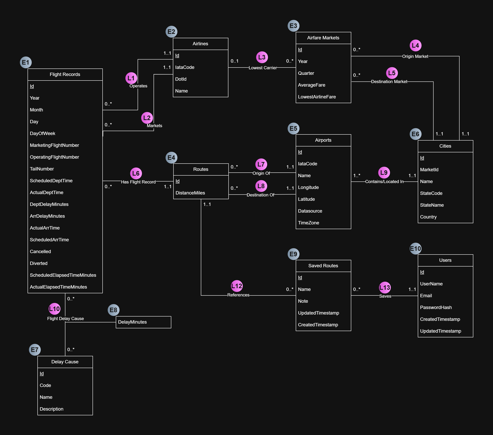

# Entities

| \# | Description | Assumptions |
| :---- | :---- | :---- |
| E1 | **Flight records** are created as its own entity because this accounts for the main source of our dataset. We've extracted row-level information like airline/carrier information and broken those out into separate entities as the dataset contains all carrier related information in each row of the dataset. We've reduced the complexity of the data in each row through extracting useful information to the context of our project. | One of the key assumptions of this table is that we assume our users will, as part of their query, want to identify flights during a similar month/day/time of the year, for which we will have the ability to aggregate delay details (as well as cancellation/diverted frequencies) through SQL queries. We've selected specific columns in the dataset to enable this type of functionality. |
| E2 | **Airline information** is separated out as its own entity as it is referenced throughout multiple datasets. This extracts the relationship into a commonly referenced entity, for which we can stitch our datasets together to drive aggregation of data and analytical value. | We assume that the IATA Code and DOT ID can act as the stitching point between datasets as this is a common standard of identifying carriers across our three datasets.  An IATA code is a unique 3-letter identifier assigned to airports or 2-character identifiers assigned to airlines by the International Air Transport Association (IATA). Commercial airports, which are relevant to the project, have an identifying IATA. US DOT Numbers as unique safety identifiers for commercial passenger and cargo operators. |
| E3 | Our DOT dataset references the concept of **airfare markets** in each row. These markets define an origin and destination city, which will be the core entity we use to represent the DOT dataset.  | We cannot guarantee that every single route will have corresponding airfare market data, but we should be able to reference airlines and cities which should act as our strategy to connect the DOT dataset to our other entities. Unlike Airports, we use cities as the connector for two city markets. This is because flight searches can search between metropolitan areas rather than specific airports. |
| E4 | **Routes** are a commonly referenced entity in the BTS dataset, where in each row of the flight record it defines an origin and destination. We extract this information as its own entity as we should want to organize flight records by the route for which it’s operating upon. | Routes are directional, and should be extracted as an entity from the BTS dataset. |
| E5 | The **airport entity** is extracted from the BTS dataset, and enriched with data from OFD to establish a core airport entity with metadata for our users to visualize location, timezone and city information. | We assume each airport belongs to one city. We also assume to tie timezone information to the airport instead of the city, as the airport entity contains accurate lat/lon data. An IATA code is a unique 3-letter identifier assigned to airports or 2-character identifiers assigned to airlines by the International Air Transport Association (IATA).  |
| E6 | **Cities** (like airlines) acts as another point in which we connect data from BTS to DOT, in that we should be able to identify airport information to deduce cities for BTS, and extract city names from DOT. This should help us aggregate flight record data as well as airfare markets. |  |
| E7 | As described above, this entity represents the set of causes for delay and is broken out as it is a repeated reference by many flight records.  | We’ve identified the collection of delay causes through the data profile in the BTS dataset page itself.  |
| E8 | **Flight delay cause** detail represents the delay information for a specific flight record and a specific delay cause. It captures the number of delay minutes attributed to that cause, allowing one delayed flight to be associated with multiple causes while preserving the minutes contributed by each cause. | We assume delay cause detail records are only created when a flight record has a relevant delay cause reported in the BTS data. The `DelayMinutes` value represents the minutes attributed to that specific cause for that specific flight record. Flights with no reported delay cause may have no associated Flight Delay Cause records. |
| E9 | This is created as its own entity as it represents a many-to-many relationship between users and routes. As users are able to save many routes they wish to follow, we need this entity to hold a reference to which user is interested in which route. This also serves its purpose since each route could be followed by many users.  | We provide the functionality to hold only one note per saved route. This means once a route is created, we would only allow the user to overwrite the content of the notes per saved route.  |
| E10 | This models each of the users of our application. | We aim to perform some sort of hashing of user passwords so as to not store plaintext sensitive information into our tables.  |
| E11 | **States** identifies the state from which the city belongs to, and is referenced by cities through the StateCode. | All cities should belong to a state, which is a reasonable assumption to all US cities. |
| E12 | **Airport Markets** identify a specific market / airport relationship. They are weak entities as they rely on airport / market keys to identify them. | We assume airports belong to at least one airport market. Without this assumption, we cannot bring up price data with regards to that particular airport and will have to report inadequate data on a request for that airport’s information. |
| E13 | **City Market ID**, which is sourced from the DOT dataset, is a unique identifier assigned to a city market to consolidate multiple airports serving the same region. | We assume that DOT city market data could be cleaned and matched with data from BTS. The main challenge would be that DOT dataset references markets through metropolitan areas, whereas the referenced airport data in BTS specifies specific cities. If mapping is not possible, then we would have to notify the user that market data isn’t available or is limited. We’ve kept the cityMarketID to maintain the reference relationship that is found in the DOT dataset. Since this identifier is unique to that dataset and that it doesn’t exist in the BTS dataset, we’ve kept it for better consistency when performing our data loading process. |

# Relationships

| \# | Description | Cardinality/Assumptions |
| :---- | :---- | :---- |
| L1 | Connects airlines to flight records operated | One flight record can only be operated by one airline. This is different than the marketed airline (L2) as in reality this can vary. One airline could operate many flight records; we also account for the case that some airlines may not have any flight records as it may be an airline company that didn’t operate within the timeframe of our selected datasets.  |
| L2 | Connects airlines to flight records marketed | Similar to L1, each flight record can be marketed by one airline, which can be the same as the operated airline. One airline could market many flights belonging to different flight records, where we also account for the case that some airlines may not market any flight records in the dataset timeframe. |
| L3 | Connects airfare markets and the airline that has the lowest fare in the given year/quarter | This is the only reference to airlines we aim to utilize from the DOT dataset that specifies which airline has the lowest fare for a given city-to-city-market. Each airfare market should have an airline that has the lowest fare for that particular market; we still account for the possibility that perhaps there are rows where lowest airline fare information may not exist, hence the potential of 0 airlines referenced. An airline could provide the lowest fare in multiple airfare markets during different time periods, conversely it may never appear to be at all.  |
| L4 | Connects the origin markets of airfare markets to the city which it references | Each airfare market has exactly one origin city, and each city can act as the origin in multiple airfare markets or none at all if the data doesn’t exist. This is different than the destination market relationship (L5). |
| L5 | Connects the destination markets of the airfare markets to the city which it references | Similar to L4, each airfare market has exactly one destination city, and each city can act as the destination in multiple airfare markets or none at all if the data doesn’t exist.  |
| L6 | Connects a route to its historical flight records | All flight records in the BTS dataset should reference only and exactly one route (which is defined as a directed relationship between two airports). However, one route may not have any flight records as a safeguard in case routes are derived from a different source other than the BTS dataset.  |
| L7 | Connects the origin airport to a particular route | All routes must have exactly one origin airport to satisfy our definition of a directed relationship between two airports. Each airport can be the origin in many routes, this represents all outbound/departures of a given airport. However, there could be some airports that isn’t commercially operated (such as executive airports), hence certain airports may not have any associated routes. |
| L8 | Connects the destination airport to a particular route | Similar to L7, all routes must have exactly one destination airport to satisfy our definition of a directed relationship between two airports. Each airport can be the destination in many routes, this represents all inbound/arrivals of a given airport. However, there could be some airports that isn’t commercially operated (such as executive airports), hence certain airports may not have any associated routes.  |
| L9 | Connects airports to the city in which it is located | All airports should obviously exist in only one city. Cities need not have an airport. |
| L10 | Connects a flight record to its delay cause and associated delay metadata | Not all flight records may have flight delay causes, i.e. flights that are perfectly on time (or even early/ahead of schedule). All flight delay causes, as it’s an associative entity between delay data and it’s corresponding flight record, must be referenced to exactly one flight record.  |
| L11 | Connects a flight delay cause to a lookup entity containing the delay causes | Each flight delay cause row references exactly one delay cause type, as each different delay cause would be a separate flight delay cause row for a particular flight record. Each delay cause can be referenced by many flight delay causes, as many flights can be delayed for the same reason.   |
| L12 | Connects saved routes by a user to the route the user is interested in | Each saved route, which represents users’ interest in following a given route, should reference exactly one route. Each route, however, could be a point of interest for many users. Similarly, some routes may not be followed by any user. |
| L13 | Connects saved routes to the user who created it | Each saved route belongs to exactly one user. A user can save many routes they would like to follow, or none at all.  |
| L14 | Relates a city to the state it belongs in. | We assume all cities should belong to one and only one state, and that all states should have at least one city involved in our dataset as each state should have one operational commercial airport. |
| L15 | Relates airport market to airports | Each airport corresponds to any number of airport market combinations, while those tuples correspond to a singular airport. |
| L16 | Connects airport market to markets the refer to | Airport markets correspond to the market within their tuple, while each market corresponds to any number of airport markets. |
| L17 | Relates markets to states they belong to | A state can house many markets, but each market is situated in a single state. |
