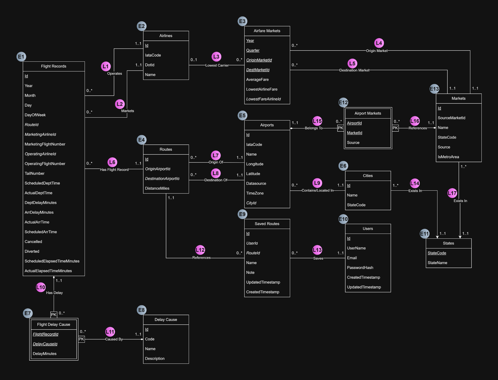
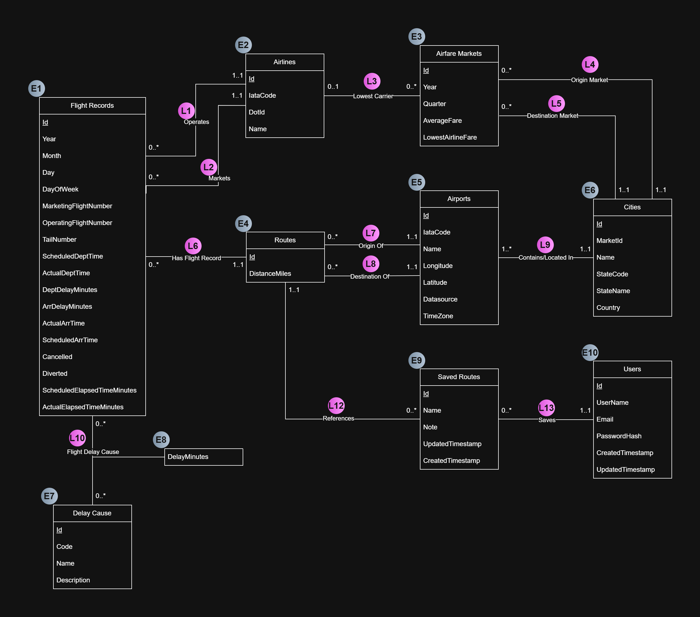

# Stage 2 Revisions

This file summarizes the Stage 2 revisions we made based on the grading feedback.

## Feedback Addressed

For Stage 2, we lost 1 point on the ER/UML diagram section. The comment was:

> UML diagram should not contain FKs, FKs are implementation-level not conceptual-level.

The main fix here is that we updated the UML diagram to remove foreign key attributes from the conceptual model. We also adjusted the delay cause modeling so that `Flight Delay Cause` is represented as a relationship entity rather than keeping it as a weak entity style table in the UML.

## Files Updated

- `doc/assets/UML_V2.png` — updated UML diagram
- `doc/stage2_revisions.md` — this revision explanation file
- `doc/assets/UML_V1.png` — old UML diagram included for comparison only

## UML Diagram Comparison

| Old UML Diagram | Revised UML Diagram |
|---|---|
|  |  |

## What Changed

### 1. Removed foreign keys from the UML diagram

The biggest issue in the original diagram was that we included foreign key attributes directly inside entity boxes. For example, several entities had attributes like `RouteId`, `MarketingAirlineId`, `OperatingAirlineId`, `OriginMarketId`, `DestMarketId`, `CityId`, `UserId`, etc. These make sense once we translate the design into relational tables, but they do not belong in the conceptual UML diagram.

In the revised version, we removed those implementation-level foreign key attributes from the UML entities and let the relationships/associations represent those connections instead.

### 2. Changed `Flight Delay Cause` from weak entity style modeling to a relationship entity

The original diagram modeled `Flight Delay Cause` more like an entity/table that existed between `Flight Records` and `Delay Cause`. After reviewing the feedback and our design, we changed this into a relationship entity. This better reflects what we are trying to model conceptually: a flight record can have delay cause information, and the relationship also carries the `DelayMinutes` attribute.

This still translates cleanly into the relational schema later, but the UML version is now less implementation-specific.

### 3. Kept the relational meaning the same

The goal was not to redesign the whole project. We mainly cleaned up the UML so that it is closer to a conceptual design instead of looking like the final SQL schema. The same major entities are still present: `Flight Records`, `Airlines`, `Routes`, `Airports`, `Airfare Markets`, `Cities`, `Users`, `Saved Routes`, and `Delay Cause`.

The relationships are still intended to preserve the same meaning as before, but now the foreign key details are left for the relational schema / implementation stage.

## Comments Addressed

This revision addresses the Stage 2 grading comment that foreign keys should not be included in the UML diagram because they are implementation-level, not conceptual-level. The revised diagram removes those FK-style attributes and represents those links through UML relationships instead.
